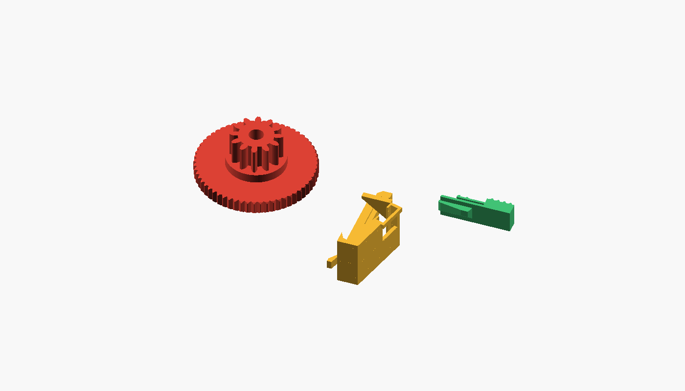
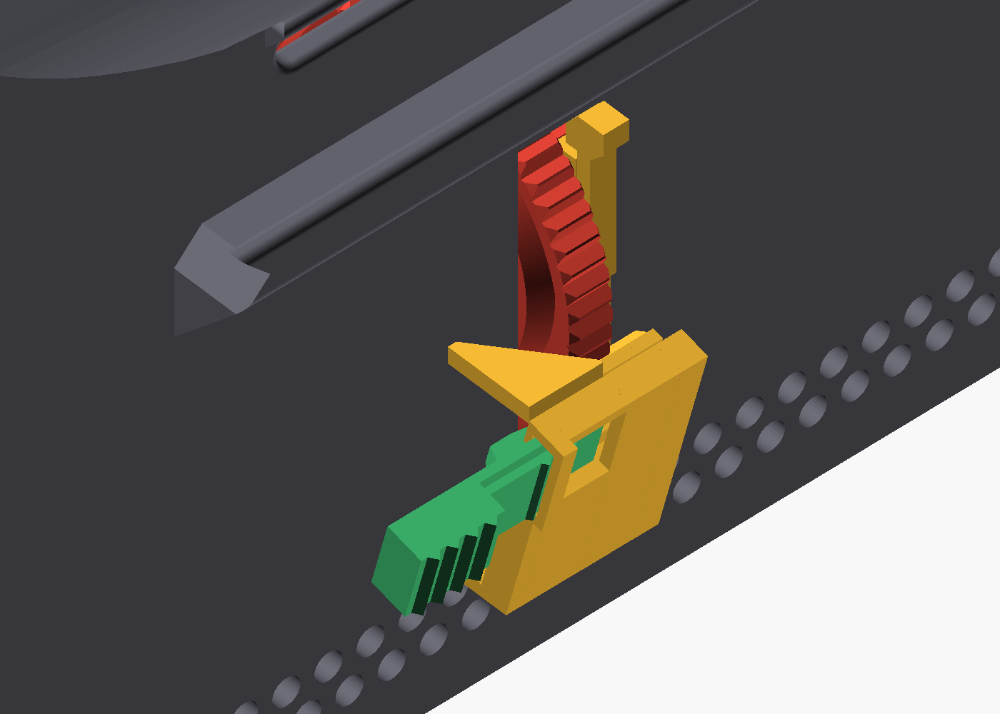
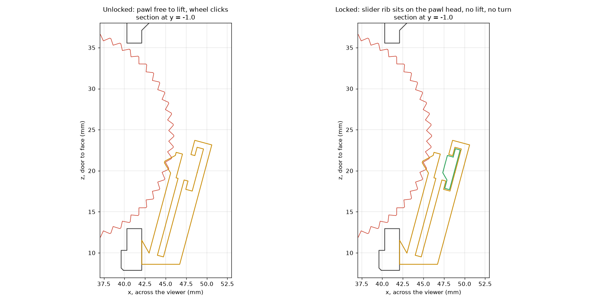

# Focus click-and-lock

The focus carriage slides on its own when the wearer looks up or down. This replaces the focus wheel
and adds a clip with a positive lock. **Nothing else is reprinted**, and there is no glue and nothing
to buy; the existing axle screw goes back in.





## What was wrong with the numbers

Measured off the meshes that were actually printed (the slicer project's shell and carriage match the
stretched STLs to 0.0000 mm) and pinned to the STEP assembly frame.

**The first assumption was wrong: the wheel does have a detent, on the face you can't see.** Upstream
put 28 V-notches on the wheel's hidden face, and the shell has a matching spring: a 2.4 x 2.0 mm finger,
16 mm long, with a nub that drops into them. The rim itself is smooth, not knurled.

| | measured |
|---|---|
| Notches | 28, 90 degree V, 0.80 deep, r 8.92 to 11.52 |
| Nub engagement | 0.53 mm, into the same 45 degree flanks |
| Pinion and rack | module 0.8, 12 teeth, pitch radius 4.8, 30.16 mm of rack per turn |
| **Old step** | **1.08 mm per click**, about 0.5 to 0.9 dioptres depending on lens (34 to 45 mm) |
| Backlash in CAD | 0.02 mm, effectively none |
| Axle | not a printed pin. Bosses with 3.3 and 3.6 mm bores and a nut pocket 5.7 across flats, 2.6 deep: an M3 screw and nut, by the look of it (assumed) |
| Wheel between bosses | 10.5 in an 11.0 gap, 0.5 mm of float |
| Rail gaps | 0.2 mm wheel side, 0.4 mm far side, 0.1 to 0.2 mm in y, 0.05 mm rack end to boss |
| Carriage travel | stops at -8.4 mm (flange on rim). Toward the face there is no stop: the rack runs off the pinion at about +8, calculated from its length |

**The load.** The carriage is 42.5 g solid, about 29 g as sliced (3 walls, 15% infill; estimated from
the slices, not weighed), up 20% on upstream because of the stretch. Lenses are assumed at 2 to 4.5 g
each. That is 33 to 52 g, so 0.37 to 0.51 N along the rail at full tilt and 1.8 to 2.4 N*mm at the
wheel; at 3 g of head motion, 5.4 to 7.3 N*mm.

**On paper, the old detent should hold.** Finger stiffness gives 8 to 12 N*mm, 3 to 5 times the static
load. Since the printed one doesn't, something in the print is losing it: the 0.8 mm notches are the
wheel's first four layers, the nub is a 1 mm stub printed sideways, and the shell had supports enabled.
A photo of the printed viewer shows a rough notch face on the wheel. **That cause is inferred, not measured**, and
the design doesn't depend on it, because it doesn't use the nub at all.

**The stretch is not the cause, and the mesh survived it.** The axle, the finger, the slot and the rack
all moved +3.5 mm together. The new and old wheels both show zero overlap with the stretched carriage
from -8.4 to +9 mm of travel (at most 0.0007 mm³, which is numerical noise). One harmless artefact: the cut
plane clips the nut pocket's corner, so the pocket is 10.08 long rather than 6.58. The nut can slide
along it, but the screw is located by the bores either side.

## What the parts do



- **`focus-wheel.stl`**: same outside radius and pinion, with **60 teeth on the rim, 0.50 mm of focus per
  click**. That is 0.25 to 0.44 D a click, so never more than 0.22 D from the sharpest setting, which is
  within the eye's typical depth of focus of about 0.3 D. The teeth double as a grip. The rim is 3 mm wide instead of 5,
  which leaves room in the slot, and a groove on the back clears the old nub, so the finger is left unloaded.
- **`clip-*.stl`**: hooks behind the wall at one end of the wheel's slot and locates in the other. It
  carries a pawl on an 11 mm beam, which clicks through the teeth. Nothing about this relies on a spring staying
  sprung: the pawl rests almost unloaded, holding by geometry, because it has to climb a 45 degree flank to move.
- **`slider.stl`**: a thin 8 degree wedge. **Push it toward the wheel and it sits on the pawl, so the
  pawl can't lift and the wheel can't turn.** It wedges tight whatever the print tolerance, and stays there on friction.

The clip engages only the **slot**: both its ends and the wall's outer and inner faces. All of these
were measured on the printed mesh: slot y +/-3.00, z 12.95 to 35.55, wall x 40.30 to 42.10.

### The numbers, per clip

From the actual tooth outlines, solving pawl lift against wheel angle. E = 1800 MPa, assumed. Ranges
run from 0.25 mm of slack on the axle to none. Holding torque ignores friction, which only helps it.
Click force assumes friction of 0.2 to 0.3.

| | beam | Holding torque | Click, at the rim | Peak strain | At rest |
|---|---|---|---|---|---|
| `clip-soft` | 0.90 | 6 to 12 N*mm | 0.7 to 1.7 N | 0.74% | 0.21% |
| **`clip-standard`** | **1.05** | **9 to 19 N*mm** | **1.1 to 2.7 N** | **0.87%** | **0.24%** |
| `clip-firm` | 1.15 | 12 to 25 N*mm | 1.4 to 3.5 N | 0.95% | 0.26% |

Standard holds 4 to 8 times the static load, and 1.3 to 2.6 times the 3 g load before friction. The
strain is low and the rest stress is near zero, so creep has little to work on, and if the small rest
load does relax, the pawl still has its full climb. Locked, about 10 to 15 N at the rim would flex the
arch far enough to skip a tooth (estimated). Thumb forces could reach that if you force it, but gravity
is at most 1.5 N.

## Printing

PETG, 0.4 nozzle, no supports, no brim. **Print each STL exactly as exported.**

| Part | Face down | Settings |
|---|---|---|
| `focus-wheel.stl` | groove side | 0.16 mm, 4 walls, 40% infill |
| `clip-standard.stl` | the flat side with the tongue | 0.12 to 0.16 mm, walls only (100%) |
| `slider.stl` | on its side, as exported | 0.12 mm, walls only (100%) |

Printing the clip on its side is the point: **every flexure bends in the plane of the layers, never
across them**. Keep the slicer's elephant-foot compensation on, keep the outer wall slow enough for the
teeth to stay crisp, and keep the seam off the pawl tooth.

The wheel's groove ceiling is a 1.7 mm bridge. The clip's cap is a 5.3 mm bridge. Neither is critical.

## Fitting

1. Door off, phone out. Wind the carriage toward the face until the rack leaves the pinion, and lift
   it out through the face end.
2. Undo the axle. Move the old wheel away from the wall, then out. Look at the finger and nub while
   you're there, and note what the axle actually is.
3. New wheel in, pinion toward the rack as before, axle back. **It should spin freely with no click yet.**
4. Carriage in, door on. As with upstream's wheel, the rack can still be wound off the pinion toward the face.
5. Push the slider, tip first, into the clip's open end (the end with the small bridge) until it clicks past
   the bridge, then pull it back to its stop.
6. Fit the clip with the slider's pad on the wearer's right. Put the hook into the door end of the slot, with
   the clip about 1.6 mm toward the face. Press it flat; the keeper rides up on the wall. Slide it
   toward the door until the keeper drops into the far end of the slot with a click.

To remove it, lift the keeper's tab with a fingernail, slide the clip 1.6 mm toward the face, and lift it out.

**To use it:** roll the wheel to focus; it clicks. Push the pad toward the wheel, 2.5 to 3.5 mm, until
it stops: locked. Pull it back until the stop catches: free.

## Tuning

- **Slips, or feels vague:** `clip-firm`. **Too stiff to roll comfortably:** `clip-soft`. Only the clip changes.
- **The wheel binds on its axle:** the bore is 3.2 mm so the pawl can't just push the wheel aside. If it
  prints tight, run the screw through it or ream it.
- **Lock won't bite:** check the slider reaches its stop at about 3.5 mm. If it does, the pawl head sits low;
  print the clip with a larger `preload`.
- Everything is a parameter at the top of `focus-brake.scad`. Change `teeth` for a different step (72 gives
  0.42 mm, at the cost of crispness). Regenerate with:

```sh
openscad --backend=manifold -D 'PART="wheel"' -D 'SRCDIR="/path/to/Mobile+VR+viewer+for+modern+smartphones"' -o focus-wheel.stl focus-brake.scad
openscad --backend=manifold -D 'PART="clip"' -D 'FIRMNESS=1' -o clip-standard.stl focus-brake.scad   # 0 soft, 1 standard, 2 firm
openscad --backend=manifold -D 'PART="slider"' -o slider.stl focus-brake.scad
```

## Checked

On the stretched meshes, by boolean intersection, with upstream's wheel as the control where it applies:

- **Clip against shell and door: 0 mm³.** Slider against shell and wheel: 0 mm³, unlocked and locked.
- **New wheel against shell: 0 mm³** through rotation (the old one touches at 0.08 mm³), and still 0 with the wheel floated 0.5 mm into the nub, where the old wheel overlaps it by 1.1 mm³.
- **Clip and slider against carriage: 0 mm³** across all travel.
- Wheel against clip: one contact only, at the pawl tooth, which is the designed preload.
- The hook clears the slot's end with the clip shifted 1.45 mm or more, and slides home touching nothing but the keeper, which rides up on the wall as designed.
- All five STLs are watertight, one part each. The slicer's own check agrees (`manifold = yes`, `number_of_parts = 1`).

## Not verified

**Nothing here has been printed or fitted. Every force is calculated, not measured.**

- Real click and holding force, which depend on tooth rounding, friction and stiffness as printed.
- The slicer: a headless slice hung or crashed here, so no print has been previewed. The only check is a
  layer-by-layer estimate that no feature is too thin for a 0.4 mm bead. Look at the slice before printing.
- **The elastic door cord.** The photo shows it running around the top of the shell. The clip's door edge is
  at z 8.60, which should clear it; if not, it will sit on the foot, which is harmless.
- Thumb reach: the rim shows over about 49 degrees now, 11 mm of arc against upstream's 21 mm. The clip
  stands about 5 mm above the rim, and the pad about 6.
- Lens masses. The 2 to 4.5 g is calculated from the BOM's lens, not weighed.

**Please check on the viewer:**

1. Does the old wheel click at all, and is the nub there? That settles what actually failed.
2. Is the axle an M3 screw? The 3.2 mm bore assumes it.
3. Measure the wall beside the slot: 1.80 mm is the design. The hook's ramp takes up about +/-0.1 mm.

## Licence

**CC BY-NC-SA 4.0**, the same as upstream's model, credit brenpoly. `focus-wheel.stl` contains upstream's
pinion teeth, and the clip and slider are sized to its geometry, so this folder is treated as a derivative.
As with [`../upstream-stretch/`](../upstream-stretch/), the rest of this repository is Apache-2.0 and this folder is the exception.

## Files and licence

As in [`../upstream-stretch/`](../upstream-stretch/), the generated STLs are not committed: the wheel
carries the upstream viewer's pinion, and that geometry is CC BY-NC-SA 4.0, which this folder's parts
inherit where they derive from it. Build them from `focus-brake.scad`, with `SRCDIR` pointing at the
unzipped upstream download.
