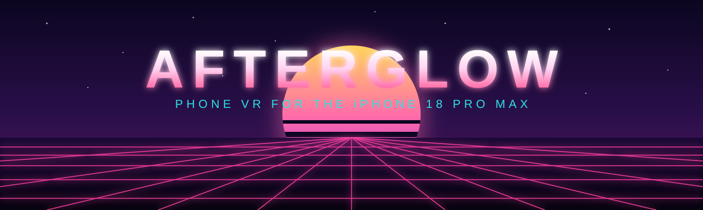

<p align="center">
  
</p>

<p align="center">
  <a href="https://github.com/blaineam/Afterglow/actions/workflows/ci.yml"></a>
  
  
  
</p>

<h3 align="center">Phone VR, done properly, for the iPhone 18 Pro Max.</h3>

<p align="center">
  Your photos and videos in 3D. Panoramas and 360 photos all around you. A WebXR browser your
  hands can reach into. Games in your own room. All on the phone in your pocket and a viewer you
  print, free and open source.
</p>

**Afterglow** is a native Swift, Metal and ARKit app for Cardboard-style viewers that goes well
past what Cardboard ever did: **6DoF head tracking** from ARKit, **camera passthrough**, **hand
tracking** on the Neural Engine (pinch, grab, point, two hands), a **WebXR browser** that gives
pages your hands, **spatial photos and videos**, **panoramas** and **360 photos as the
surroundings**, twenty-four bundled photospheres, a visionOS-style interface of glass windows
with a launcher, a dock and a phone view, and eight games with lit 3D graphics. It is built and
tested on the **iPhone 18 Pro Max** with its own printed viewer.

## Repository

| Where | What |
|---|---|
| [`ios-native/`](ios-native/) | The app: the Xcode project (generated from `project.yml`), the Swift sources, the Watch app, the unit tests and the app's own [README](ios-native/README.md), which is the full reference. |
| [`Tools/`](Tools/) | `native_build_and_run.sh` (build, install, launch, log, test, Simulator harness), the fixture-media makers and the EXR converter. |
| [`Hardware/`](Hardware/) | The printed viewer: OpenSCAD source, STLs, bill of materials, listing text. |
| [`docs/`](docs/) | The project site and its images. |
| [`unity/`](unity/) | The earlier Unity app, kept whole for reference with its own README, tools and (disabled) workflows. It is no longer developed; the native app replaced it on the phone on 2026-11-06. |

## Start here

1. **Print the viewer**: the three parts in [`Hardware/`](Hardware/) (OpenSCAD source, STLs,
   [bill of materials](Hardware/BOM.md), [MakerWorld listing](Hardware/MAKERWORLD.md)).
2. **Build the app** on a Mac with Xcode 27 and [xcodegen](https://github.com/yonaskolb/XcodeGen)
   (`brew install xcodegen`), signed into an Apple ID (a free personal team is enough), the phone
   unlocked and plugged in:

   ```sh
   zsh Tools/native_build_and_run.sh --ei passthrough 1
   ```

   The script generates the project when `project.yml` is newer, builds, installs, launches
   and prints the start of the session log. `--launch` relaunches what is installed, `--log`
   pulls the session log, `--test` runs the unit tests, `--sim` runs the Simulator harness.
3. **Put the phone in the viewer.** The launcher opens ahead over the surroundings; look down for
   the round button at your feet to bring the dock. Pinch to select, or tap the viewer's button.

Everything else, from the stereo rig and the pinch rules to each app and game, the phone view,
the launch options and the Simulator harness, is in [`ios-native/README.md`](ios-native/README.md).

## Requirements

- An iPhone with LiDAR and ARKit world tracking (built and tuned on the iPhone 18 Pro Max; the
  lens geometry is the printed viewer's).
- macOS with Xcode 27 and xcodegen to build; the Apple Watch app is optional.
- iOS 26.

## Tests and continuous integration

`zsh Tools/native_build_and_run.sh --test` runs the unit tests (lens geometry, hand geometry,
the pinch detector, browser helpers, media metadata) in the Simulator. The GitHub workflow in
`.github/workflows/ci.yml` does the same on every push: it generates the project, builds for
the Simulator with warnings as errors, runs the tests and parses the tools.

## Logs

The app writes `Documents/session.log` (`[Frames]`, `[Thermal]`, `[Pose]`, `[Hands]`,
`[Pinch]`, `[WebXR]`, `[Media]`, `[Games]` and the rest, one line each); the build script
copies it after a launch and `--log` pulls it any time. Known issues are in
[KNOWN_ISSUES.md](KNOWN_ISSUES.md), the plan in [ROADMAP.md](ROADMAP.md).

## Privacy and the network

Everything runs on the phone. The network is used only by the browser, by Apple Music through
MusicKit when you play it, and by two optional lookups the rhythm game makes for a song's
tempo (the second behind a key file you place). Nothing is sent anywhere else.

## License

Apache-2.0, as the upstream project. Third-party notices, including the Unity app's packages,
are in [THIRD_PARTY_NOTICES.md](THIRD_PARTY_NOTICES.md).
